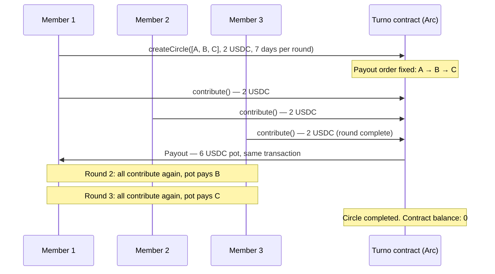

# Turno

**Everyone gets their turn.**

Turno is a savings circle — a practice found under a hundred names around the
world — rebuilt on [Arc](https://docs.arc.io) with USDC.

A group of 2–10 people agree on a fixed contribution. Every round, each member
pays that amount into the Turno contract. The moment the last contribution
lands, the full pot is paid to that round's member — automatically, inside the
same transaction. Rounds rotate until everyone has collected once.

**The contract holds the pot. Not the organiser, not a company, not Turno.
Nobody can run with it: money leaves the contract in exactly two ways — the
scheduled payout to the member whose turn it is, or a refund of your own
contribution if a round stalls past its deadline.**

- Live app: _deployed on Vercel — see [Deployment](docs/DEPLOYMENT.md)_
- Hackathon: [Arc Microgrants Round 2 — Built with Arc Studio](https://dorahacks.io/hackathon/arc-microgrants-2/detail) (closes Sun 2026-11-01)
- Contract reference: [`contracts/Turno.sol`](contracts/Turno.sol)

---

## Contents

- [Why Turno exists](#why-turno-exists)
- [How it works](#how-it-works)
- [Quickstart](#quickstart)
- [The contract](#the-contract)
- [The app](#the-app)
- [Repository structure](#repository-structure)
- [Testing](#testing)
- [Deployment](#deployment)
- [Arc details](#arc-details)
- [Status and roadmap](#status-and-roadmap)
- [Contributing](#contributing)
- [License](#license)

## Why Turno exists

Savings circles move serious money on pure trust, and they fail in one place:
whoever holds the pot. Organisers abscond, collectors keep sloppy ledgers,
members dispute who paid what, and payouts get delayed or argued over in a
group chat.

The apps that exist today fix the *record-keeping* — reminders, ledgers,
tracking — and deliberately do not touch the money (one leading savings-circle
app states it plainly: "tracking only — no wallet, no escrow"), or they hold
funds as a licensed custodian, in one currency, in one country.

Turno removes the trusted holder entirely:

| | Ledger apps | Turno |
| --- | --- | --- |
| Who holds the money | A person (tracked by the app) | **The smart contract** |
| Who triggers the payout | The organiser, when they get to it | **Code — inside the final contribution transaction** |
| Custodian / licence needed | Yes, if the app holds funds | **No custodian exists** |
| Currency & reach | Local currency, local users | **USDC on Arc — a member in Lagos and a member in London in one circle** |
| Proof | Screenshots and chat messages | **Every payment verifiable on the Arc explorer** |

## How it works



1. **Create a circle** — member wallet addresses (in payout order), a fixed
   contribution (e.g. 5 USDC) and a round length (1 hour to 90 days).
2. **Each round, every member pays in** — the app shows who has paid and who is
   still owing.
3. **The last contribution pays the pot out** — automatically, to the member
   whose turn it is. There is no payout button for anyone to forget, delay or
   redirect.
4. **The circle completes** when every member has collected once.
5. **If a round stalls** — still unfinished after its round length — members
   who already paid can take their own contribution back. The first refund
   closes the circle. Late contributions are still accepted until someone does.

Worked example (the demo used everywhere in this repo): 3 members × 2 USDC →
a 6 USDC pot per round, 3 rounds, 3 payouts, and every member finishes exactly
where they started — having received their lump sum at a different point in
the cycle, which is the entire point of a savings circle.

## Quickstart

### Run the app locally

```bash
npm install
npm run dev        # http://localhost:5173
```

With no contract address configured, the app runs in **preview mode**: an
in-browser simulator of a 3-member circle, clearly labelled, so anyone can see
exactly how a circle behaves before touching a wallet.

### Point the app at a deployed contract

Copy `.env.example` to `.env` and set:

```bash
VITE_ARC_NETWORK=mainnet            # or: testnet
VITE_TURNO_CONTRACT_ADDRESS=0x…     # deployed Turno contract
```

Rebuild/restart and the app switches to live mode: wallet connect (with
automatic Arc network switching), circle creation, live circle state, and the
approve → contribute flow.

### Test the contract logic locally

```bash
npm install
npm run test:contract
```

The harness compiles `contracts/Turno.sol` against a mock USDC and runs it on
a local chain, asserting: creation is validated (member count, zero and
duplicate addresses, contribution, round length); the pot pays out inside the
final contribution transaction of each round; double contributions,
non-members and post-completion contributions revert; the contract ends
empty and every member nets zero over a full cycle; a stalled round can only
be refunded after its deadline, only by members who paid, closes the circle,
and leaves the contract empty; late contributions still complete a round and
the next round gets a fresh deadline. Revert tests check the revert reason,
not just that something failed. Expected final line: `ALL TESTS PASSED`.
Contract transactions in the harness set an explicit gas limit — ganache's
estimator intermittently under-prices the final-round payout transaction — and
the app uses the node's estimate plus a 30% buffer for the same reason.

## The contract

One contract, [`contracts/Turno.sol`](contracts/Turno.sol), manages any number
of circles. Full reference: [docs/CONTRACT.md](docs/CONTRACT.md).

| Function | What it does |
| --- | --- |
| `createCircle(members, contribution, roundDuration)` | New circle; `members` is the payout order (2–10, no duplicates); `roundDuration` is in seconds (1 hour to 90 days) |
| `contribute(circleId)` | Pay this round's contribution; pays the pot out if the round completes |
| `refund(circleId)` | After a round's deadline, take back your own contribution to that stalled round; the first refund closes the circle |
| `getCircle` / `getMembers` | Circle state (incl. `cancelled`, `roundEnd`) and member list |
| `hasPaid` / `canRefund` / `currentRecipient` / `potSize` | What the app renders |

**Security posture, by construction:**

- **No owner, no admin, no fee.** There is no privileged account to
  compromise. Money leaves the contract only as the scheduled payout to
  `members[round]`, or as a refund of a member's own contribution to a stalled
  round.
- **State before transfers** (checks-effects-interactions), and paid-flags are
  keyed by round, so a round can never pay out twice and a contribution can
  never be refunded twice.
- **Known limit — default risk.** A refund returns only the stalled round's
  contributions. Pots already paid out are final, so a member who collects
  early and then stops paying leaves later members behind. Form circles with
  people you trust; collateral is post-grant work. The test harness asserts
  this outcome so it stays documented.
- **The contract is the reference implementation.** For the Arc Microgrants
  submission, the deployed contract is generated, tested and deployed in
  **Arc Studio** (an eligibility requirement) following
  [`studio/STUDIO_PROMPTS.md`](studio/STUDIO_PROMPTS.md), and verified
  function-by-function against this reference. The contracts are unaudited —
  use small amounts.

## The app

A Vite + React app in [`src/`](src/), talking to the contract with ethers v6.
The UI is built on **Tailwind CSS v4** with **shadcn/ui-style components**
([`src/components/ui`](src/components/ui) — Button, Card, Badge, Input,
Textarea, Alert — owned in-repo, not a dependency) themed to the ink/lime
brand, plus Magic UI-style components in
[`src/components/magic`](src/components/magic) (Marquee, DotPattern,
BorderBeam, BlurFade) and an Aceternity-style bento grid.
Plain language throughout — *circle, turn, pot, pay in, collect* — and every
transaction state is visible; there are no silent buttons, and every
transaction links to the Arc explorer. Each circle has an **invite link**
(`/?circle=<id>#app`) with one-tap WhatsApp and Telegram sharing, so a
circle can be started where these groups already live. Network parameters,
ABIs and wallet network-switching live in [`src/turno.js`](src/turno.js).
More detail: [docs/ARCHITECTURE.md](docs/ARCHITECTURE.md).

## Repository structure

```
turno/
├── src/                  # Web app (Vite + React + Tailwind v4 + ethers)
│   ├── App.jsx           # Landing + preview simulator + live on-chain app
│   ├── components/ui/    # shadcn/ui-style components (owned, themed)
│   ├── components/magic/ # Magic UI-style Marquee / DotPattern / BorderBeam / BlurFade
│   ├── lib/utils.js      # cn() helper (clsx + tailwind-merge)
│   ├── turno.js          # Arc network config, ABIs, wallet helpers
│   └── styles.css        # Tailwind v4 theme tokens (ink / lime / paper) + keyframes
├── contracts/
│   ├── Turno.sol         # Reference contract (Solidity ^0.8.24)
│   └── local-test.mjs    # Compile + logic tests: full cycle, refunds, reverts (solc + ganache)
├── studio/
│   └── STUDIO_PROMPTS.md # The Arc Studio build script (prompts, gates, checklist)
├── submission/
│   └── SUBMISSION.md     # DoraHacks submission copy + demo video script
├── docs/
│   ├── ARCHITECTURE.md   # System design and decisions
│   ├── CONTRACT.md       # Contract reference: functions, events, invariants
│   └── DEPLOYMENT.md     # Vercel, environment variables, mainnet runbook
├── BRAND.md              # Name, wedge, voice, visual identity
└── README.md
```

## Testing

- **Contract:** `npm run test:contract` (`contracts/local-test.mjs`) — see
  [Quickstart](#quickstart). Covers creation validation, contribution rules,
  all three payout rounds, completion, stalled-round refunds, late
  contributions, revert reasons and final balances.
- **App:** `npm run build` must pass; preview mode is exercised by clicking
  through a full circle in the browser.

## Deployment

- **Web app:** Vercel, connected to this repository — every push to `main`
  deploys. Environment variables and the mainnet runbook are in
  [docs/DEPLOYMENT.md](docs/DEPLOYMENT.md).
- **Contract:** Arc Studio → Arc testnet rehearsal → Arc mainnet, per
  [`studio/STUDIO_PROMPTS.md`](studio/STUDIO_PROMPTS.md). Amounts stay small;
  submissions are not audited by Arc or Circle.

## Arc details

| | Mainnet | Testnet |
| --- | --- | --- |
| Chain ID | `5042` (`0x13b2`) | `5042002` (`0x4cef52`) |
| RPC | `https://rpc.mainnet.arc.io` | `https://rpc.testnet.arc.network` |
| Explorer | [explorer.arc.io](https://explorer.arc.io) | [testnet.arcscan.app](https://testnet.arcscan.app) |
| Gas token | USDC | USDC (faucet: faucet.circle.com) |

USDC ERC-20 interface (both networks): `0x3600000000000000000000000000000000000000`,
6 decimals. Note Arc's dual interface: the same USDC balance is also the native
gas balance at 18 decimals — apps must use the ERC-20 interface for amounts.
The Turno contract takes the token address as a constructor argument, so the
identical code runs on testnet and mainnet.

## Status and roadmap

- [x] Brand, product spec, reference contract
- [x] Contract logic tests (local chain, full cycle)
- [x] Web app with preview mode and live on-chain mode
- [x] Public repo and documentation
- [x] Hosted on Vercel
- [ ] Arc Studio build (contract + app), testnet rehearsal circle
- [ ] Mainnet deployment + live demo circle with real USDC
- [ ] DoraHacks submission (Arc Microgrants Round 2, closes 2026-11-01)

**After the grant:** contribution history as a portable on-time record members
can carry between circles; larger circles; fiat on-ramps so a member can pay in
from a bank account while the circle still settles in USDC on Arc.

## Contributing

Issues and PRs welcome. If you change contract behaviour, update
`contracts/local-test.mjs` so the full-cycle assertions still describe the
system, and update [docs/CONTRACT.md](docs/CONTRACT.md) in the same PR.

## License

MIT — see [LICENSE](LICENSE). You keep full ownership of your circles; Turno
takes no fee and cannot move your money.
